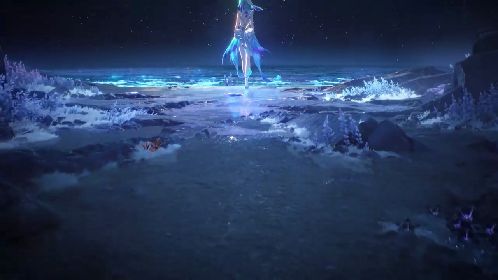

# dsh-custom-splash · 中文详细说明

> DeepSeek Harness（DSH）的**启动界面插件**：打开 DSH 时先全屏播一段**你自己的视频**，
> 播完淡出、进入主界面；也可以随时切回插件内置的六幕动画序列。
>
> English: [README.md](README.md)



---

## 目录

- [它是什么](#它是什么)
- [安装](#安装)
- [两种启动模式](#两种启动模式)
- [换成你自己的视频](#换成你自己的视频)
- [设置项全表](#设置项全表)
- [常见问题](#常见问题)
- [安全与权限](#安全与权限)
- [工作原理](#工作原理)
- [开发与测试](#开发与测试)
- [许可、致谢与免责声明](#许可致谢与免责声明)

---

## 它是什么

DSH 启动时会先注入一个「启动界面」覆盖层，播放完成后再揭幕让应用本体显示出来。
本项目提供两种覆盖层实现：

| 模式 | 播放内容 | 配置项 `source` |
|---|---|---|
| **视频模式**（默认） | 你指定的本地视频文件，铺满窗口，播完淡出 | `video` |
| **内置六幕动画** | 上游项目自带的六幕交互序列（真声台词 + 界面音效） | `builtin` |

视频模式下连设置页里「身份名称 / 语音 / 配色 / 文案」那些只对六幕序列生效的选项都会自动隐藏，
避免出现「改了没反应」的困惑。

### 特性

- **换视频不用重装**：把 mp4 覆盖到固定路径 `~/.dsh/startup-video/boot.mp4` 即可，
  也可以填任意绝对路径（文件或目录）。
- **首帧就是黑的**：插件在 `<head>` 里同步加 `dsu-lock` 类并在 `<body>` 第一个孩子挂黑底覆盖层，
  第一帧就盖住应用本体，不会先闪一下主界面再出视频。
- **边下边播**：视频由 Host 路由 `/dsh-startup/media/<文件名>` 提供，支持 HTTP Range（206）、
  HEAD 与 seek；不缓存，换完刷新即新。
- **播不动也不会卡死**：带声自动播放被浏览器拒绝 → 自动降为静音重试 → 左下角给「开启声音」按钮；
  视频解不了、卡住 25 秒、或脚本报错，都会立刻揭幕放行。
- **可跳过**：右下角「跳过 SKIP」按钮（1.1 秒后淡入）、Esc、点击画面（0.9 秒后）。
- **不影响刷新体验**：默认「每次会话只播一次」，同一标签页刷新不再重复播放；可改成「总是」/「每天」。

---

## 安装

### 方式一：插件市场

在 DSH 的插件市场里搜索 `dsh-custom-splash` 安装（上架后可用）。

### 方式二：命令行装 tgz

```bash
dsh plugin --profile web add ./dsh-custom-splash-1.0.0.tgz
```

Windows 上也可以解压 release 压缩包后**双击「安装.cmd」**，脚本会完成同样的操作。

### 方式三：直接指向本地目录（开发时用）

```bash
dsh plugin --profile web add link:D:\工作区\插件\dsh-custom-splash
```

### 桌面版（DeepSeek Harness Desktop）

桌面版的 profile 不能从命令行管理（会被拒绝），两种做法：

1. **插件管理器**：桌面端「设置 → 插件」里安装 tgz；
2. **用 `plugin_manager` 工具**（DSH 内的 agent 可用）：`install_bundle`，`target` 传
   `file:<tgz 的绝对路径>` 或仓库目录。

装完必须**从托盘完全退出桌面端再打开**（不是最小化），新插件才会加载。

### 环境要求

| 项 | 要求 |
|---|---|
| 平台 | DSH **web** profile 或 **Desktop** 桌面端 |
| Node | **>= 20** |
| 依赖 | 无（不需要 `npm install`） |

### 卸载

```bash
dsh plugin --profile web remove dsh-custom-splash
```

桌面端在插件管理器里移除即可。卸载后启动界面不再出现，也不会有残留黑屏。

---

## 两种启动模式

### 视频模式（默认）

- 覆盖层里放一个 `<video autoplay playsinline>`，`object-fit` 由「画面适配」决定。
- 播放结束（`ended`）→ 600 ms 淡出 → 移除覆盖层 → 派发 `dsh-startup:done`。
- 播放被拒（浏览器自动播放策略）→ 静音重试 → 仍失败则直接揭幕。
- 首帧事件触发后移除 `dsu-boot`（否则宿主 9 秒兜底会把覆盖层提前摘掉）。

### 内置六幕动画

上游原版序列，完整保留在 `lib/splash.js` + `lib/splash.css`：

| # | 中文主字 | 英文副标题 | 需要操作 |
|---|---|---|---|
| 1 | 需要访问许可 | `ACCESS PERMISSION REQUIRED` | 点按钮 / Enter / 空格 |
| 2 | 身份资料确认 | `IDENTITY VERIFICATION` | 点按钮 / Enter / 空格 |
| 3 | 接收访问需求 | `ACCESS REQUEST RECEIVED` | 自动 |
| 4 | 开始读取权限 | `PERMISSION READ STARTED` | 自动 |
| 5 | 读取完毕 · 核验通过 | `READ COMPLETE · VERIFIED` | 自动 |
| 6 | 欢迎「身份名称」访问 | `WELCOME, NAME` | 自动 |

真声台词 + 界面音效的素材在 `lib/assets/` 下，**只随上游保留**，本项目没有新增或替换音频。

---

## 换成你自己的视频

### 最快的办法：覆盖这一个文件

```
%USERPROFILE%\.dsh\startup-video\boot.mp4
```

例如 `C:\Users\<你的用户名>\.dsh\startup-video\boot.mp4`。把任意 mp4 覆盖成它，
重启 DSH（桌面端从托盘 Quit 再打开）即生效，**不需要重装插件**。

这个路径读不到时会自动回落到插件自带的 `lib/assets/video/boot.mp4`，所以删掉它也不会黑屏。

### 换个位置：设置页填绝对路径

**设置 → 启动动画 → 视频绝对路径**：

- 填**单个文件**的绝对路径 → 直接播它（文件名必须和「视频文件名」或该文件同名，见下方白名单）；
- 填**目录**的绝对路径 → 在该目录里找「视频文件名」指定的文件；
- 留空 → 用插件自带素材；
- **相对路径一律被丢弃**（不会被拼到工作目录上）。

### 格式与编码建议

浏览器能解的是最常见的组合：

| 项 | 建议 |
|---|---|
| 视频编码 | **H.264 / AVC**（`libx264`），`yuv420p` |
| 音频 | **AAC**，48 kHz，立体声 |
| 容器 | `mp4`（`webm` / `m4v` 也认） |
| 分辨率 | 1080p 足够（覆盖层是铺满窗口，4K 只会更吃解码） |
| 体积 | 建议 < 20 MB，**必须** `-movflags +faststart`（否则要下完才播） |

`.mov` 里的 ProRes / QTRLE / HEVC / 带 alpha 的素材很多浏览器解不了，先转一道：

```bash
ffmpeg -i 原素材.mov -vf scale=1920:1080:flags=lanczos \
  -c:v libx264 -preset medium -crf 20 -pix_fmt yuv420p \
  -c:a aac -b:a 192k -movflags +faststart boot.mp4
```

本仓库自带的 `boot.mp4` 就是这么来的：15.5 秒 / 1080p60 / 15.5 MB。

### 文件名白名单

媒体路由只放行 `[A-Za-z0-9._-]` 组成、且扩展名为 `mp4 / webm / m4v` 的文件名；
`/media/../../package.json` 之类的目录穿越一律 404。「视频文件名」也因此不要带空格、中文或斜杠。

---

## 设置项全表

**DSH 设置页 →「启动动画」**。改完立即生效（下一个会话/刷新时体现）。

### 播放

| 选项 | 默认 | 作用 |
|---|---|---|
| 启用 | 开 | 总开关，关掉完全不播 |
| 动画来源 | 我的动画视频 | `我的动画视频` 播视频 / `插件内置六幕动画` 走原版授权序列 |
| 视频绝对路径 | `~/.dsh/startup-video/boot.mp4` | 可直接替换的固定位置；也可填别的绝对路径或目录，留空=用插件自带素材 |
| 视频文件名 | `boot.mp4` | 路径是目录时按它找；路径留空时也用它去 `lib/assets/video/` 找 |
| 画面适配 | 铺满窗口 | `铺满窗口` 裁切填满 / `完整显示` 留黑边 |
| 静音播放 | 关 | 默认出声；自动播放被拦会降级静音，左下角出现「开启声音」按钮 |
| 视频音量 | 0.8 | 0 – 1 |
| 显示模式 | 每次会话 | `每次会话` 每个浏览器会话一次 / `总是` 每次刷新都播 / `每天` 一天一次 |
| 允许跳过 | 开 | 是否显示跳过按钮、是否响应 Esc 与点击 |

### 仅内置六幕序列生效

| 选项 | 默认 | 作用 |
|---|---|---|
| 主题 | 暖白 | `暖白` 参考片原色 / `暗色` 暗底板 |
| 速度 | 1× | 整段动画快慢，0.35 – 3 倍 |
| 要求确认 | 开 | 第 1、2 步是否等点击才继续 |
| 身份名称 / 编号 / 权限等级 | `JOYCE MOORE` / `0087` / `3` | 终幕欢迎语与第二步身份卡 |
| 语音播报 / 语音来源 / 音色 / 语速 / 音调 / 音量 | 开 / 真声素材 / 自动 / 0.88 / 0.85 / 0.9 | 台词播报 |
| 播报前提示音 / 开口前留白 | 开 / 240 ms | 提示音与开口间隔（0 – 1200 ms） |
| 界面音效 / 音效音量 / 音效来源 | 开 / 0.5 / 内置素材 | 「哒」声 |
| 强调色 / 故障色 A / B | `#ff7500` / `#ff3b30` / `#2971b8` | 阶段条、色散故障 |
| 品牌三行 / 黑幕三行 / 终幕方框 / 页脚 | 见设置页 | 文案 |

---

## 常见问题

**Q：装完重启了，还是没看到启动界面？**
1. 设置页有没有「启动动画」这一项？没有 → 插件没挂载成功，检查安装日志与 profile 的 `package.json`；
2. 「启用」是不是被关掉了？「显示模式」是不是 `每次会话` 而本会话已经播过？换 `总是` 试一次；
3. 桌面端要**从托盘完全退出**再打开，仅关闭窗口不生效。

**Q：视频不播放 / 黑屏 / 直接进主界面？**
- 多半是编码问题：用 `ffprobe` 看是不是 H.264 + yuv420p + AAC；
- 也可能是自动播放被拦：把「静音播放」打开试试（静音自动播放不受策略限制）；
- 脚本出错或 25 秒没起播会自动揭幕，页面不会黑着——可以去开发者工具 Console 搜 `[dsh-custom-splash]`。

**Q：没有声音？**
默认有声，但浏览器要求「用户与页面交互过」才准出声。被拦下时会降级静音并在左下角给
「开启声音」按钮，点一下就有声了。

**Q：刚打开时先闪一下主界面？**
本版本已在 `<head>` 里同步加锁、`<body>` 首个子节点挂黑底覆盖层，正常情况第一帧就是黑的。
若仍有闪烁，说明宿主版本在更早的时机就绘制了窗口内容，可以打开「主题 → 暗色」减轻观感，
或把视频开头剪成纯黑帧。

**Q：换了视频但没变化？**
媒体路由是 `Cache-Control: no-store`，刷新即新；如果真的没变，确认覆盖的是
「视频绝对路径」实际指向的那个文件（设置页底部会显示「当前视频：…」）。

**Q：接口返回 401？**
`/dsh-startup/*` 路由带信任栅栏，只认本机回环地址 + 宿主的信任标记；
从非 127.0.0.1 或非宿主页面直接访问会得到 401，这是预期行为。

**Q：关掉「启用」后页面全黑？**
不会。启动脚本检测到 `enabled:false` 会移除 `dsu-lock` 与关键样式表，直接放行。
如果真遇到了，刷新页面即可恢复。

---

## 安全与权限

- 插件**只读**本地视频文件，不写任何用户文件（除了自己的配置 JSON）。
- 没有任何网络出站请求；没有遥测、没有外部 CDN。
- 配置写入 `~/.dsh/dsh-custom-splash.json`（旧版 `dsh-startup.json` 会被兼容读取）。
- 媒体路由只允许白名单文件名，拒绝目录穿越；返回 401/404 而不是文件内容。
- 内置音频素材来自上游项目，本插件未新增音频。

---

## 工作原理

```
Host 半侧 lib/index.js
  ├─ tapIndex(html)  在 <head> 注入：关键 CSS（黑底 + 固定层）+ 配置 + EARLY_LOCK_JS
  │                  在 <body> 注入：<div id="dsh-startup-root" class="dsu-root dsu-video dsu-boot">
  │                                 + BOOTSTRAP_JS（模式判定/9 秒兜底）
  └─ 路由（前缀 /dsh-startup）
       ├─ /splash.css /splash.js     内置六幕序列（仅 builtin 模式注入）
       ├─ /boot-video.js             视频运行时（仅 video 模式注入）
       ├─ /media/<文件名>            视频字节流：Range 206 / HEAD / no-store
       ├─ /asset/<文件名>.mp3        内置序列音频
       └─ /config                    GET 读 / POST patch|reset

浏览器半侧
  ├─ lib/boot-video.js   覆盖层 + <video> + 跳过/开启声音 + 25 秒看门狗 + finish()
  ├─ lib/client.js       设置页「启动动画」面板；Host 未注入时自举覆盖层
  └─ window.__DSH_STARTUP_API__.replay()  可重播
```

兼容点：

- 路由基址沿用 `/dsh-startup`（短、已测），不随包名变化；
- 配置文件名换成 `dsh-custom-splash.json`，但**先读旧名** `dsh-startup.json`，升级不丢设置；
- 设置分组 id 保持 `startup-screen`，排序不变；
- 前端存储键改为 `dsh-custom-splash:shown` / `dsh-custom-splash:day`。

---

## 开发与测试

```bash
npm test          # 四套冒烟测试：host / splash / client / desktop-boot（254 项断言）
npm run pack:release   # npm pack 到 release/
```

仓库结构：

```
lib/index.js        Host 半侧：配置、注入、六条路由
lib/boot-video.js   视频运行时（零依赖，全内联样式）
lib/splash.js       内置六幕序列运行时
lib/splash.css      内置六幕序列样式
lib/client.js       设置页面板
lib/assets/         音频素材 + 视频素材
test/               四套 smoke 测试（node:test 风格的自写断言）
preview/            离线预览页（不随 npm 包发布）
docs/               截图与发布文档
```

改完代码想在本地 DSH 里试：`dsh plugin --profile web add link:<仓库绝对路径>`，
然后刷新页面（Host 半侧改动需要重启 DSH）。

---

## 许可、致谢与免责声明

### 许可

MIT。本项目基于 [`6shenhonghong9/dsh-startup-screen`](https://github.com/6shenhonghong9/dsh-startup-screen)
（同样 MIT）修改而来，内置六幕序列、样式、音频素材与文案均来自上游；
本次新增的是视频模式、可替换路径、首屏防闪与相关设置项。

### 第三方素材

内置六幕序列的视觉风格参考自动画作品，人声与音效素材取自第三方视频，
相关权利归原权利人所有。本项目不对这些风格与素材主张任何权利，也未获得任何授权或背书。

### 免责

本项目为个人学习与娱乐性质的开源插件，不用于任何商业目的，**未授权任何商业用途**。
使用者自行替换的视频、音频之权利与合规由使用者自行负责。若权利人认为本项目侵犯了其合法权益，
请联系作者，作者将在核实后立即移除相关内容。
